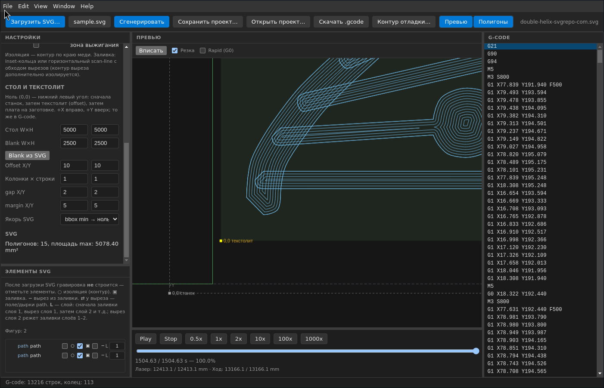

# KoolSlicer

Готовые сборки можно скачать во вкладке [Releases](https://github.com/kugimiya/KoolSlicer/releases).

Десктопное приложение (Electron + React) для лазерной гравировки печатных плат: из SVG с медью оно строит G-code для GRBL. Один проход лазера идёт по краю каждого контура меди, так что дорожки остаются, а лишняя медь вокруг них выжигается.

KoolSlicer рассчитан на самодельные лазерные станки с прошивкой GRBL и на экспорт плат из EasyEDA и других редакторов. На выходе — файл в абсолютных координатах станка, который можно сразу отправить на контроллер.



## Что делает

- Импортирует SVG платы (`path`, `rect`, `circle`, `polygon`, смещённый `viewBox`, `transform` на группах).
- Распознаёт медь: заливки и обводки (`polyline` / `line`), в том числе белую медь из EasyEDA (`#FFFFFF`).
- Строит **изоляцию** — одну линию по краю каждого выбранного контура.
- Строит **заливку** области: концентрические кольца, горизонтальный scan-line или двойной scan-line (сначала вертикаль, потом горизонталь), с обходом вырезов.
- Раскладывает копии платы на текстолите: колонки, строки, зазоры и поля.
- Показывает превью траекторий на столе и проигрывает рез с оценкой времени, длины реза и холостых ходов.
- Выдаёт G-code (GRBL, лазерный режим) и сохраняет проект.

## Какие проблемы решает

- Обычные слайсеры для лазера режут вектор «как нарисовано» и не умеют изоляцию PCB: нужен контур строго по краю меди, а не заливка всей дорожки.
- Экспорт из EasyEDA часто приходит белой заливкой и белой обводкой на тёмном фоне — такие файлы другие программы отбрасывают или трактуют как пустые.
- Координаты SVG (ноль сверху, Y вниз) не совпадают с G-code (ноль снизу слева, Y вверх). KoolSlicer приводит всё к одной системе и запекает смещение заготовки в абсолютные координаты станка.
- На одной заготовке обычно нужно несколько копий платы. Ручная раскладка в CAM легко съезжает относительно реального куска текстолита на столе.
- Перед резкой не видно, что именно выжжется: какие контуры включены, где зазоры, сколько займёт проход и где лазер едет вхолостую.

## Возможности

- Дерево элементов SVG: гравировка не строится, пока элемент не отмечен.
- Режимы элемента: изоляция, заливка, вырез из заливки, номер слоя.
- Слои 1…99: сначала заливки слоя, затем вырезы. Вырез слоя *N* действует на все накопленные заливки слоёв 1…*N*.
- Ширина луча, число проходов, подача реза и холостого хода, мощность `S` / `maxS`, режим `M3` или `M4`.
- Оптимизация холостых ходов по сетке.
- Превью зоны выжигания, вписывание вида и показ rapid (`G0`).
- Плеер траектории: от 0.5× до 1000×, счётчик строк и длины лазера и хода.
- Проекты: сохранить и открыть, скачать `.gcode`.

## Быстрый старт

Нужны [Node.js](https://nodejs.org/) и npm.

```bash
npm install
npm run dev
```

Откроется окно Electron. Дальше: **Загрузить SVG…** → отметить элементы → **Сгенерировать** → **Скачать .gcode**.

## Портативная сборка под Windows (x64):

```bash
npm run dist
```

## Linux и Windows, x64 и arm64 (AppImage и portable `.exe`):

```bash
npm run dist:portable
```

Файлы появятся в `release/`: `KoolSlicer-Portable-<version>-<arch>.exe` и `KoolSlicer-<version>-<arch>.AppImage`.

## Как пользоваться

1. Задайте стол (ширина и высота рабочей области) и заготовку: размер текстолита и смещение `Offset X/Y` его нижнего левого угла от нуля станка.
2. При необходимости нажмите **Blank из SVG** — размер заготовки подстроится под плату с учётом полей.
3. Загрузите SVG. Траектории сами не появятся: в дереве слева отметьте нужные элементы.
4. Настройте лазер: `beamSize`, проходы, подачи, мощность и стратегию заливки.
5. Нажмите **Сгенерировать**, проверьте превью и плеер, затем скачайте G-code.

### Элементы SVG

| Значок | Режим |
| --- | --- |
| ○ | **Изоляция** — линия по контуру элемента |
| ▣ | **Заливка** — гравировка всей области внутри элемента |
| − | **Вырез** из заливки (дырка в элементах с ▣; изоляция по контуру элемента остаётся) |
| L | **Слой** (1…99) |

Удобная схема слоёв: заливка дочернего элемента на слое 1, вырез родителя на слое 2. Вырез слоя 2 снимает медь со всех заливок слоёв 1–2, а контур самого выреза дополнительно изолируется.

### Координаты

Везде одна система: **(0, 0) в нижнем левом углу**, **+X вправо**, **+Y вверх** — как в G-code.

- **Станок** — home = нижний левый угол рабочей области.
- **Текстолит** — `Offset X/Y` = нижний левый угол заготовки на столе. Это ноль платы для гравировки.
- **Плата** — SVG после импорта (ось Y перевёрнута). Якорь `bbox min → ноль платы` ставит нижний левый угол габарита в поле панели; `origin SVG` оставляет исходное начало координат файла.

Несколько копий задаются колонками, строками, зазором `gap` и полем `margin`.

### GRBL

- Включите лазерный режим: `$32=1`.
- `$30` (максимум шпинделя / S) должен совпадать с **maxS** в программе: 255, 1000 или 10000 — как в прошивке.
- В файле координаты **абсолютные**, в системе станка. Смещение заготовки уже запечено, `G92` для платы не используется.

### SVG из EasyEDA и других редакторов

Поддерживаются `path` (заливка и обводка), `rect`, `circle`, `polygon`, смещённый `viewBox` и `transform` на группах. Белая заливка и белая обводка меди — нормальный экспорт EasyEDA, импорт их не отбрасывает.

## Разработка

```bash
npm test          # vitest: геометрия, офсеты, раскладка, G-code
npm run build     # сборка electron-vite
npm run preview   # просмотр собранного приложения
```

Стек: Electron, React, Vite, TypeScript, Zustand, [js-angusj-clipper](https://github.com/xaviergonz/js-angusj-clipper), Paper.js.

## Лицензия

MIT
